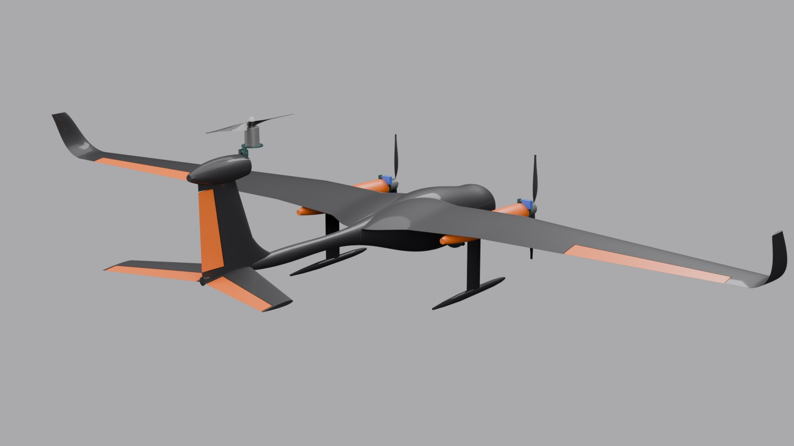

# Trailhawk



A tri-tiltrotor VTOL drone I designed to build myself. It takes off straight up from a trail, flies on its wing, and circles 100 m above a hiker on high mountain trails, scanning the trail ahead for wildlife with a thermal and a color camera. It comes apart to fit in a backpack.

It is designed, analyzed and flight-simulated, and ready to build. Every bought part is a real product, priced in November 2026, and the airframe splits into pieces a home 3D printer can print. It isn't built yet.

**See it live:** [the 3D model](https://trailhawk.vercel.app) and [the flight simulator](https://trailhawk.vercel.app/sim/).

## The problem

On a high trail you can't see past the next ridge, where there might be elk, moose or a bear. A small drone overhead could look ahead, but it has to take off from a trail with no runway, fly long enough to follow a hike in thin mountain air, and pack into a backpack. It also has to be buildable at home from parts you can buy.

## Requirements

| Requirement | Target | Result |
| --- | --- | --- |
| Hover in thin air | 1.6× the thrust needed to hover, at 12,000 ft and 10 °C on a sagging battery | 1,619 g per motor against 1,582 g needed |
| Weight | Under the heaviest takeoff at 12,000 ft: 2,955 g | 2,896 g (59 g to spare) |
| Flight time | 45 min circling at 12,000 ft | 48 min |
| Balance | Center of gravity at 25–30% of the wing's mean chord | 27% |
| Strength | Every checked part holds 1.5× its limit load: 5.1 g in flight, 6.7 g landing | Weakest margin +36% (the wing root tube) |
| Packs into a backpack | Every section fits a 65 L pack (700 × 350 × 260 mm) | All fit |
| Printable at home | Every piece fits a 256 mm print bed | 48 pieces, all fit |
| Prop clearance | Props stay 25 mm from the airframe at every tilt | 27 mm at the closest |
| Mission | Circle 100 m above the hiker, under the 120 m (400 ft) drone limit, all the way to the lake | No crash; 100.4–100.6 m above him, 72–113 m above the ground below |

Each result is computed from the CAD model and checked by the automated tests (`python -m unittest`).

## Design

- **Tri-tiltrotor.** Three motors lift it off the trail like a drone. Then the two front motors tilt forward, the rear one stops, and it flies on its wing. Circling takes 113 W against 531 W to hover, so the wing is what makes 48 minutes possible.
- **Sized for thin air.** At 12,000 ft the motors lose about a quarter of their thrust. The hover margin there is the tightest requirement, and it sets the weight limit. An airspeed sensor on the nose keeps the transition and slow circling safe, where GPS ground speed is a poor stand-in.
- **Two cameras.** On a turret that sweeps the trail ahead, a $172 thermal camera (160 × 120 pixels) finds warm spots, and a color camera identifies them, read by an onboard AI board. A thermal camera with 3× the resolution costs $2,131, so it's the upgrade, not the start.
- **Built to print and pack.** The airframe splits into 48 pieces for a 256 mm printer. Carbon tubes run through the wing and boom and slide apart at dry joints, so it breaks down into sections that fit a backpack.
- **Black, so heat-proof plastic.** A black skin can reach 55 °C in mountain sun, where lightweight PLA softens, so the black parts print in LW-ASA, which holds to about 96 °C.

## What I'd test first

1. Print one wing panel and weigh it. The printed-part weights are estimates, and there's only 59 g to spare.
2. Load a wing joint until it breaks. The dry joints are untested designs.
3. Check the real motor and tilt servo against the CAD before printing their mounts.
4. Hover-test only inside the hover limit: at 12,000 ft, up to 19 °C.

## Parts and cost

Prices checked November 19, 2026, in USD before shipping and tax.

| Qty | Part | Price |
| --- | --- | --- |
| 3 | [T-Motor AT2820 Long Shaft KV880](https://store.tmotor.com/product/at2820-long-shaft-fixed-wing-motor.html) motors | $179.97 |
| 6 | [APC 12x6E](https://www.apcprop.com/product/12x6e/) props: 4 normal, 2 reverse, spares included | $29.22 |
| 2 | [Hobbywing XRotor Pro 50A](https://www.readymaderc.com/products/details/86939-hobbywing-xrotor-pro-50a-opto-esc-dual-pack) ESC 2-packs: 4 ESCs, 1 spare | $149.98 |
| 1 | [Flywoo Explorer 4S2P 9000 mAh](https://flywoo.net/products/flywoo-explorer-molicell-p45b-21700-4s2p-9000mah-lionpack-battery) Li-ion battery | $69.99 |
| 1 | [Holybro Kakute H743-Wing](https://holybro.com/products/kakute-h743-wing) flight controller | $105.00 |
| 1 | [Foxeer M10Q-180 V2](https://racedayquads.com/products/foxeer-gps-m10q-180-gps-compass) GPS and compass | $23.99 |
| 1 | [RadioMaster RP3 V2](https://radiomasterrc.com/products/rp3-expresslrs-2-4ghz-nano-receiver) ExpressLRS receiver | $19.99 |
| 1 | [Matek ASPD-4525](https://www.mateksys.com/?p=7212) airspeed sensor, with pitot tube | $49.87 |
| 1 | [Matek BEC12S-Pro](https://racedayquads.com/products/matek-bec12s-pro-9-55v-to-5-8-12v-5a) 5 V regulator for the Pi | $22.99 |
| 2 | [KST X12-708](https://www.buddyrc.com/products/kst-x12-708-brushless-micro-servo-9-3kg-cm-0-07sec-60degree) tilt servos | $120.00 |
| 2 | [KST X08 Plus](https://www.buddyrc.com/products/kst-x08-plus-digital-servo-8-4v-0-09s-5-3kg-cm-73oz-in) aileron servos | $90.00 |
| 3 | [KST X06](https://www.buddyrc.com/products/kst-x06-digital-servo-8-4v-0-07s-1-8kg-cm-24oz) tail servos | $135.00 |
| 1 | [Raspberry Pi 5, 4 GB](https://www.adafruit.com/product/5812), with active cooler and camera cable | $145.90 |
| 1 | [Raspberry Pi AI HAT+](https://www.pishop.us/product/raspberry-pi-ai-hat-13-tops/), 13 TOPS | $76.95 |
| 1 | [FLIR Lepton 3.5](https://groupgets.com/products/flir-lepton-3-5) thermal camera | $172.00 |
| 1 | [PureThermal 3](https://www.sparkfun.com/purethermal-3-flir-lepton-smart-i-o-board.html) board for the Lepton | $129.95 |
| 1 | [Raspberry Pi Camera Module 3](https://www.pishop.us/product/raspberry-pi-camera-module-3/) | $29.25 |
| — | Carbon tubes, 7 sizes from 6 to 18 mm, roll-wrapped | $157.88 |
| 5 | Filament: 3 spools of LW-ASA (black), 1 of LW-PLA, 1 of nylon for the center fitting | $243.99 |
| — | Wiring, connectors, fasteners, glue and hinge pins (estimate) | $131.00 |
| | **Aircraft** | **$2,082.92** |

To fly it you also need a radio ([RadioMaster Boxer](https://radiomasterrc.com/products/boxer-radio-controller-m2), ELRS, $153.99), a charger ([ToolkitRC M7AC](https://racedayquads.com/products/toolkitrc-m7-ac-200w-15a-2-6s-dc-smart-charger-with-xt60-xt30-plug), $91.49) and two microSD cards ($34.90). That makes **$2,363.30** in all.

Sourcing notes:
- The GPS in the model, the Matek M10Q-5883, is discontinued. The Foxeer above replaces it and is smaller and lighter, but its plug isn't checked against the flight controller.
- The battery is now made with different cells (BAK P45D), so re-check its current rating.
- T-Motor parts may be hard to get in the US right now.
- colorFabb LW-ASA has a 5–6 week lead time.
- The airspeed sensor was out of stock at the two US stores checked; the price is ReadyMadeRC's.

## Run it

```bash
python3 -m venv .venv && source .venv/bin/activate
pip install -r requirements.txt
python -m trailhawk.sim          # the 3D model and the flight simulator at http://localhost:8123/
python -m unittest           # every check (about 5 minutes)
```

It needs Python 3.10 or newer (built with 3.14), and Node.js for the simulator's checks, which are skipped without it.

- `trailhawk/` holds the model and its analyses, in Python with [build123d](https://github.com/gumyr/build123d).
- `tests/` holds the automated checks.
- `site/` is the website: the 3D model page and the flight simulator.

Every command, model detail and number is in [REFERENCE.md](REFERENCE.md).

## License

MIT: see [LICENSE](LICENSE). The GitHub icon on the site is from [Hugeicons](https://hugeicons.com) (MIT), and the hawk in the favicon is Andy Wilson's silhouette from [PhyloPic](https://www.phylopic.org) (public domain).
